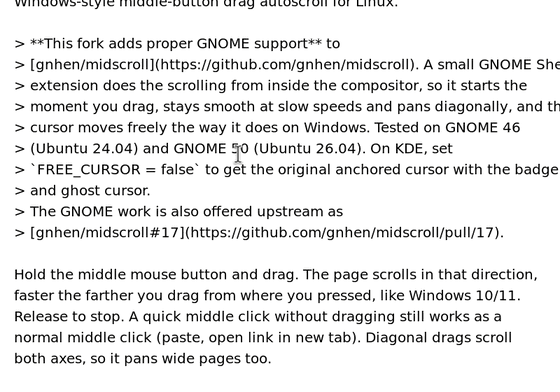

# midscroll

<a href="https://github.com/GAServantes/midscroll/actions/workflows/ci.yml"></a>
<a href="https://github.com/GAServantes/midscroll/releases/latest"></a>
<a href="LICENSE"></a>

Windows-style middle-button drag autoscroll for Linux.

> **This fork adds proper GNOME support** to
> [gnhen/midscroll](https://github.com/gnhen/midscroll). A small GNOME Shell
> extension does the scrolling from inside the compositor, so it starts the
> moment you drag, stays smooth at slow speeds and pans diagonally, and the
> cursor moves freely the way it does on Windows. Tested on GNOME 46
> (Ubuntu 24.04) and GNOME 50 (Ubuntu 26.04). Set `FREE_CURSOR = false`
> to keep the real pointer where you pressed instead, with a drawn cursor
> following your hand (GNOME and KDE), so the scroll can't wander onto a
> browser's tab strip.
> The GNOME work is also offered upstream as
> [gnhen/midscroll#17](https://github.com/gnhen/midscroll/pull/17).



<sub>Recorded in GNOME Shell 50 with the "Bars" style and speed colors: the
bar turns from green to red as you drag farther; drag back past the anchor
to scroll the other way. The default look is quieter: a small ring at the
press point and a thin line fading in toward your hand.</sub>

Hold the middle mouse button and drag. The page scrolls in that direction,
faster the farther you drag from where you pressed, like Windows 10/11.
Release to stop. A quick middle click without dragging still works as a
normal middle click (paste, open link in new tab). Diagonal drags scroll
both axes, so it pans wide pages too.

Want clicking as well as holding, like Windows? Turn on **Click to scroll
too** (in the settings GUI, or `TOGGLE_MODE = true`): a middle click
without dragging then starts autoscroll, you move the mouse to set the
speed, and the next click of any button stops it. Holding and dragging
works the same as before. On GNOME, a middle click still opens a link in a
new tab: the extension checks whether the app is showing its link hand
(the hand cursor's hot spot is read from your cursor theme, so it can't be
mistaken for the arrow). A browser's tabs, toolbar and bookmarks bar (the
top 120 px of the window) keep the middle click too, so it still closes or
opens tabs there. Everywhere else, including text boxes, a middle click
starts autoscroll instead of pasting. Without the extension (KDE, other
desktops) every middle click starts autoscroll.

It works in every app, on Wayland and X11, because it operates at the
kernel input layer (evdev in, uinput out) instead of hooking any
particular desktop or toolkit.

Details:

- The speed curve is Chromium/Edge's actual Windows autoscroll formula
  (`0.000008 * distance^2.2` px/ms). There is no dead zone: scrolling
  starts on the first pixel and the curve keeps tiny drags crawling,
  while a full-screen drag flies. A release within 6 px of the press
  point still counts as a middle click.
- The cursor moves freely while you drag, like Windows, and the scroll
  stays on the window you started in. On GNOME the midscroll Shell
  extension (`gnome-extension/`) does the scrolling itself, as smooth
  pixel scroll from inside the compositor, and keeps the pointer inside
  that window with pointer barriers until you let go. Without it the
  daemon falls back to hi-res wheel events, which libinput holds back
  for the first half notch of every scroll and every direction change.
- With a free cursor the scroll goes to whatever part of that window is
  under the pointer, so dragging up over a browser's tab strip scrolls
  the tabs (Chromium-based browsers switch tabs). `FREE_CURSOR = false`
  anchors the real pointer at the press point instead, so the scroll
  stays where you pressed, like Windows. A badge marks the press point and
  a ghost cursor (a drawn arrow on GNOME, a drawn copy of your pointer on
  KDE Plasma Wayland) follows your hand; when you let go, the real
  pointer jumps to it.
- Apps that use middle-drag themselves (FreeCAD, OrcaSlicer and Minecraft
  by default) are blacklisted by window class: while one of them is
  focused, midscroll pauses itself and the middle button behaves natively.
- The desktop and panels are left alone by default: while a desktop shell
  (plasmashell, xfdesktop, waybar, GNOME Shell, ...) is focused midscroll
  pauses, so a middle-drag can't hijack the desktop. Turn on **Enable on
  desktop & panels** (`DESKTOP_SCROLL = true`) if you want it there too.

## Install

### Fedora / RPM distros

```
./packaging/fedora/build-rpm.sh
sudo dnf install ./dist/midscroll-*.noarch.rpm
```

### Debian / Ubuntu

```
./packaging/debian/build-deb.sh
sudo apt install ./dist/midscroll_*_all.deb
```

Installs on Debian 13 "trixie" and Ubuntu 24.04 or newer. The KDE scroll
badge also needs gtk4-layer-shell (Debian 13, Ubuntu 24.10+) and kdotool,
which isn't in the Debian/Ubuntu repos, so build it
[from source](https://github.com/jinliu/kdotool); everything else works
without them, and GNOME needs neither.

### Arch

```
cd packaging/arch
makepkg -si
```

kdotool (for the scroll badge) is in the AUR.

### Manual (any systemd distro)

`sudo ./install.sh` copies the files and enables the services directly;
`sudo ./uninstall.sh` reverses it. You'll need the dependencies installed:
python3-evdev, and for the badge overlay PyGObject, GTK 4,
gtk4-layer-shell, librsvg and kdotool.

All methods install two services: `midscroll` (system, the scroll daemon)
and `midscroll-overlay` (per-user, the badge). Package installs enable
both; the overlay starts at your next login, or immediately with
`systemctl --user start midscroll-overlay`. Where gtk4-layer-shell isn't
installed the overlay skips itself.

### GNOME

Every install method also installs the GNOME Shell extension that does the
scrolling on GNOME (`midscroll-indicator@midscroll`, GNOME 45-50).
`install.sh` turns it on for you; then log out and back in once. After a
package install, log out and back in, then turn it on:

```
gnome-extensions enable midscroll-indicator@midscroll
```

(or switch on **midscroll indicator** in the Extensions app). To check it's
working, `journalctl -u midscroll -b | grep "does the scrolling"` should
show the extension connecting. Without it, midscroll still scrolls on GNOME
with ordinary wheel events, which libinput makes hesitant at slow speeds.

The extension's settings (the gear in the Extensions app, **Indicator
style** in midscroll Settings, or `gnome-extensions prefs
midscroll-indicator@midscroll`) change what's drawn while you drag, per
user and without a password:

- **Style**: *Ring and trail* (the default: a small ring at the press
  point that lights the arrows you're pulling toward, and a line fading in
  toward your hand), *Ring only*, *Bars* (the older badge and colored bars)
  or *Nothing*.
- **Color**: the desktop's accent color, *Speed* (green to red as you go
  faster) or white.
- **Size**, **Opacity** and **Show speed** (a px/s readout by the pointer).

Each change plays a short preview in the middle of the screen.

## Settings GUI

Search your app menu for **midscroll Settings** (or run `midscroll-settings`)
for a GTK window that changes every setting - speed, dead zone, event rate,
natural scrolling, the ghost cursor, the app blacklist, click to scroll and the
desktop/panels toggle - with sliders and switches. It also lists your input
devices with a switch each, so you can add a device midscroll didn't
recognise as a mouse, or tell it to leave one alone. Clicking **Apply** asks
for admin authorization (via pkexec, using midscroll's own polkit action, so
the prompt is scoped to writing this one config file), writes
`/etc/midscroll.conf` and restarts the daemon for you.

## Tuning

Prefer a text file? Edit `/etc/midscroll.conf`, then
`sudo systemctl restart midscroll`:

```
DEADZONE_PX = 0           # per-axis dead zone in pixels (0 = immediate)
SPEED_MULT = 0.008        # overall speed (bigger = faster everywhere)
SPEED_EXP = 2.2           # curve shape (bigger = more extreme at long drags)
PX_PER_NOTCH = 55         # px one wheel notch scrolls in your apps
TICK_HZ = 90              # scroll event rate (higher = smoother)
NATURAL = false           # true = inverted / touchscreen-style direction
TOGGLE_MODE = false       # true = a middle click also starts autoscroll
DESKTOP_SCROLL = false    # true = also autoscroll over the desktop and panels
FREE_CURSOR = true        # pointer follows your hand (false = anchored)
GHOST_CURSOR = true       # anchored only: draw a cursor that follows your hand
GHOST_SCALE = 1.0         # how far it travels per unit of mouse motion
SNAP_CURSOR_ON_RELEASE = true   # snap the anchored cursor to the ghost
                                # position once the drag ends
BLACKLIST = freecad, orcaslicer, minecraft
                          # window-class substrings that pause midscroll
                          # (apps with native middle-drag); '' disables
```

Values are validated on load: rates and multipliers must be strictly
positive, and anything out of bounds is rejected with a logged error while
the default is kept. Because this file also decides which devices the
daemon opens (below), it is only read when root owns it and nobody else
can write it.

Every tunable can also be overridden per run on the command line, which is
handy for trying values without editing the config:

```
sudo systemctl stop midscroll
sudo midscroll --speed-mult 0.012 --tick-hz 120 --debug
midscroll --help          # full option list
```

`--debug` turns on debug logging (device probing, focus changes, scroll
starts); `--blacklist "app1, app2"`, `--natural` / `--no-natural`,
`--toggle-mode` / `--no-toggle-mode`, `--desktop` / `--no-desktop`
(autoscroll over the desktop and panels), `--ghost-cursor` /
`--no-ghost-cursor` and `--snap-cursor` / `--no-snap-cursor`
toggle the corresponding behaviors. `--list-devices`
prints the device list and exits.

### Choosing which mice to use

midscroll picks up anything that looks like a plain relative mouse. To use
something it doesn't recognise - a trackball, a receiver's second
interface, an odd HID collection - or to leave one of your mice alone, use
the switches in the settings GUI, or the two config keys directly:

```
EXTRA_DEVICES = /dev/input/by-id/usb-Kensington_Expert-event-mouse
IGNORE_DEVICES = 046d:c548
```

Each entry is a `/dev/input` path (the `by-id` and `by-path` links are the
ones that survive a reboot), a hex `vendor:product`, or part of the device
name. `IGNORE_DEVICES` wins over `EXTRA_DEVICES`. To see every device with
its identifier and what midscroll does with it:

```
sudo midscroll --list-devices
```

The same lists work per run as `--extra-device SPEC` and
`--ignore-device SPEC`, both repeatable.

Keyboards are refused even when you list one, because that would have a
root daemon reading every key on it, and it would lose key repeat and its
LEDs passing through the virtual mirror. If you really want one, set
`ALLOW_KEYBOARDS = true` in `/etc/midscroll.conf` as root - the settings
GUI deliberately cannot ([SECURITY.md](SECURITY.md) explains why).

## Pause / uninstall

Apps in `BLACKLIST` pause midscroll automatically while focused. For
everything else:

```
sudo systemctl stop midscroll     # pause manually
sudo systemctl start midscroll
sudo dnf remove midscroll         # or apt remove / pacman -R
```

## Notes

- On GNOME the Shell extension draws the indicator and ghost cursor. With
  `FREE_CURSOR = false` it hides the real pointer while you drag, so the
  ghost (a drawn arrow, at your cursor size and always fully opaque) is
  the only cursor on screen. Mutter takes the pointer's focus away from
  apps while it is hidden unless something inhibits that, so the extension
  holds an inhibit for the length of the drag and the scroll keeps reaching
  the app. The ghost moves with your mouse's raw counts, without GNOME's
  pointer acceleration; `GHOST_SCALE` tunes it.
- On KDE the badge and ghost cursor come from `midscroll-overlay`: the
  anchor position comes from kdotool, which uses KWin's scripting API, and
  they are drawn via wlr-layer-shell. On other desktops the daemon still
  scrolls fine; there's just nothing drawn. Wayland doesn't let a background process
  change or hide the real pointer image, so the real cursor is still there
  under the badge, and the ghost is a second cursor drawn beside it rather
  than the real one moving. That's also why it can't interact with
  anything: it isn't a pointer, it's a picture of one on a click-through
  surface.
- The ghost is your actual pointer image, loaded from the Xcursor theme in
  `XCURSOR_THEME` or KDE's `cursorTheme`, at the size the compositor would
  use, and drawn at 85% opacity so you can tell it apart from the real
  one. Themes are read once at startup - restart `midscroll-overlay` after
  changing yours. A theme that can't be read falls back to a plain drawn
  arrow.
- The app blacklist needs the focused window's class, which the root
  daemon can't see itself: the `midscroll-overlay` session service polls
  it (once a second, only on change is it sent) via kdotool on KDE
  Wayland or xprop on X11, and reports it to the daemon over the state
  socket. The daemon only trusts reports from a logged-in user's helper,
  so another local process can't feed it a fake focus and pause it. No
  helper running (or another Wayland desktop) just means the blacklist is
  inactive.
- Switching into a blacklisted app takes effect within about a second
  (the poll interval), and stops an in-progress scroll too. If you press
  the middle button in that brief window right after switching, a short
  scroll may start before the daemon sees the new focus and stops it.
- Pointer speed: each mouse is re-emitted through its own uinput mirror
  that copies the real mouse's name and vendor/product IDs, so libinput and
  KDE keep applying that mouse's own pointer-speed and acceleration
  settings. If a specific mouse still loses its speed after enabling
  midscroll, set it once more in *System Settings -> Mouse* while midscroll
  is running (KDE stores it per device in `kcminputrc`) and it will stick.
- If Firefox's built-in autoscroll is enabled (`general.autoScroll` in
  about:config), turn it off so the two don't fight. It's off by default
  on Linux.
- Why not a flatpak: the sandbox forbids the raw input-device and uinput
  access this needs, and flatpaks can't run boot-time services.
- Logs: `journalctl -u midscroll -f` and
  `journalctl --user -u midscroll-overlay -f`.

## Security - please review the code yourself

midscroll runs a background daemon that reads every mouse (and writes a
virtual one) at the kernel input layer. That is a lot of trust to hand a
program you found online. **Don't take my word that it's safe - read it.**
It's deliberately small and dependency-light so you can:

- `midscroll` (the daemon) and `midscroll-overlay` (the session cursor and
  focus helper) are single, commented Python files - skim them start to
  finish.
- `midscroll-apply` is the only thing that runs as root on demand (via
  pkexec from the settings GUI); it validates every value and only ever
  writes `/etc/midscroll.conf`.
- Both systemd units are sandboxed - see `systemd/*.service`. The daemon
  runs with no capabilities at all. Run
  `systemd-analyze security midscroll.service` and
  `systemd-analyze --user security midscroll-overlay.service` to see the
  exposure score for yourself.

**[SECURITY.md](SECURITY.md)** goes through it properly: what each part
trusts, why the config file must be root-owned, why keyboards can only be
added by a root edit and never from the GUI, what the state socket does and
doesn't hand out, and what keeps a full-screen overlay from ever eating
your clicks.

Found something sketchy or a way to harden it further? Open an issue or PR -
security review is genuinely welcome.

## License

Copyright (C) 2026 G. Austin Servantes. Licensed under the
[GNU General Public License v3.0 or later](LICENSE): you may use, modify and
share it, and anything you distribute that is built on it must be released
under the same license with its source.

Based on [gnhen/midscroll](https://github.com/gnhen/midscroll), released
into the public domain under the Unlicense. The badge icon is
[move-vertical](https://lucide.dev/icons/move-vertical) from Lucide
(ISC license).
